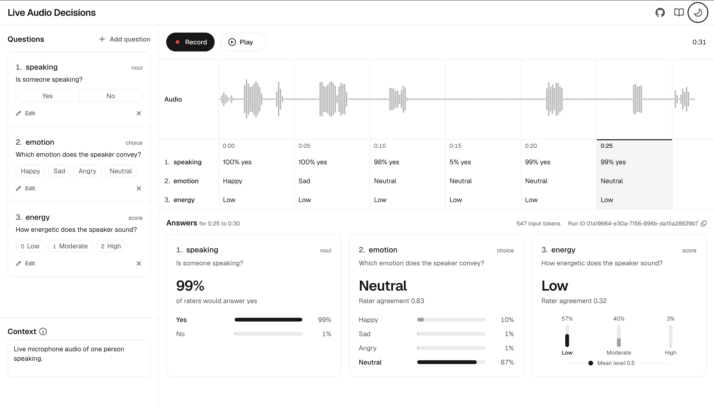

# Live Audio Decisions

A Next.js example that answers questions about live microphone audio with the [Audio Decisions API](https://dev.hume.ai/decisions/docs/overview). The app sends every 5 seconds of audio with your questions and shows each set of answers on a timeline under the waveform. The [cookbook guide](https://dev.hume.ai/decisions/cookbooks/answering-live-audio) walks through the code.

<picture>
  <source media="(prefers-color-scheme: dark)" srcset="docs/screenshot-dark.png">
  
</picture>

## Prerequisites

1. Node.js 24, the version in `.nvmrc`.
2. An API key from the [API keys page](https://cloud.hume.ai/settings/organization/api-keys) of the Hume Platform.
3. A microphone.

## Getting started

1. Clone the repository and install its dependencies. If you use nvm, run `nvm use` before `npm install`.

   ```bash
   git clone https://github.com/HumeAI/hume-audio-decisions-next-js-live-example.git
   cd hume-audio-decisions-next-js-live-example
   npm install
   ```

2. Copy the example environment file and add your API key:

   ```bash
   cp .env.example .env.local
   ```

   Then set `HUME_API_KEY` in `.env.local`. A `HUME_API_KEY` exported in your shell takes precedence over the file.

3. Start the development server:

   ```bash
   npm run dev
   ```

4. Open [http://localhost:3000](http://localhost:3000). The browser asks for microphone access the first time you press **Record**.

## Using the app

1. Press **Record** and speak. The three default questions are enough to see the app work.
2. Every 5 seconds of audio is sent with the questions. Answers appear on the timeline as they arrive, and the cards below show the newest answers in full.
3. Press **Stop**, then click a chunk or the waveform to see that chunk's answers. **Play** replays the recording from the playhead.
4. Pressing **Record** again asks before it clears the current audio and answers.
5. Add, edit or remove questions and edit the optional **Context** between recordings. A question is `noul` (yes or no), `choice` or `score`. See [Writing questions](https://dev.hume.ai/decisions/docs/writing-questions). Questions and context are kept for the browser tab, so a refresh keeps them.

All questions in a request are answered together, so adding, removing or rewording one question can change the answers to the others.

## Limits

1. The API needs at least 5 seconds of audio in a request, so only full 5-second chunks are sent. Audio after the last full chunk is kept for playback only.
2. Each chunk is one request, so a recording sends 12 requests a minute. Each organization can send 60 requests a minute, so about five recordings running at once reach the limit.

See [Limits](https://dev.hume.ai/decisions/docs/limits) for the rest.

## How it works

1. `hooks/use-recorder.ts` opens the microphone with `lib/microphone.ts`. An [AudioWorklet](https://developer.mozilla.org/docs/Web/API/AudioWorklet) in `public/audio-block-worklet.js` delivers the audio in blocks of 125 ms, which also draw the waveform.
2. `createChunker` in `lib/recording.ts` collects the blocks into 5-second chunks. For each chunk, `useRecorder` calls `askDecisions` in `lib/decisions.ts`, which resamples the audio to 16 kHz, encodes it as a WAV file with `lib/wav.ts`, and posts it with the questions and context to the `app/api/decisions` route. Chunks are sent as soon as they are ready, without waiting for earlier answers.
3. The route calls `decisions.create` on a `DecisionsClient` from the `@humeai/audio-decisions` SDK, which reads `HUME_API_KEY` on the server, so the key never reaches the browser.
4. Each answer lands on its chunk in `components/answer-timeline.tsx`, and `components/answer-card.tsx` shows the full answer. `hooks/use-playback.ts` replays the recording.

## Adapt it

1. The default questions and context are `DEFAULT_QUESTIONS` and `DEFAULT_CONTEXT` in `lib/questions.ts`. Once you edit the questions or the context in a tab, that tab keeps your version, so open a new tab to see changed defaults.
2. The chunk length is `CHUNK_MS` in `lib/recording.ts`. The API accepts 5 seconds to 5 minutes of audio in a request. Longer chunks send fewer requests, and their answers arrive less often.

## Development

1. `npm test` runs the unit tests.
2. `npm run check` runs the same checks as CI: formatting, lint, typecheck, tests and a production build.

## License

[MIT](LICENSE)
